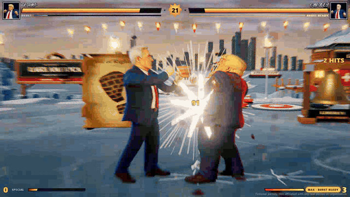
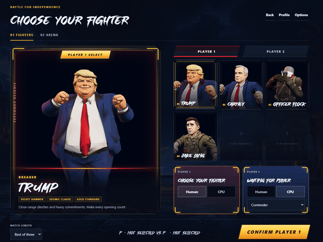
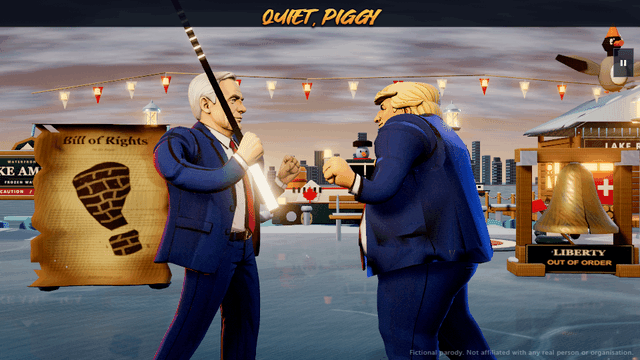
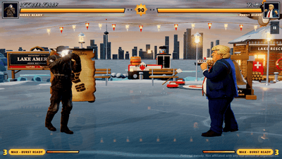

# Battle for Independence

**Battle for Independence** is a fast, ridiculous 3D fighting game built around Larger Than Life political caricatures, dramatic arenas, named Special Moves, and spectacular finishes.

Inspired by [this Reddit post](https://www.reddit.com/r/aivideos/s/oTANiZJWjz).

[**Play Battle for Independence in your browser**](https://limitedarcade.github.io/)

No account or download is required. Bring a keyboard, phone, or gamepad, pick your fighter, and settle the debate the arcade way.

Fight another player on the same machine, take on a CPU opponent, or let two CPU fighters put on a show.

The game contains exaggerated cartoon violence and gore.

## Screenshots

### Pick your fighter

### Finish it

### Officer Flock · Overwatch

### Officer Flock · Throwing stars

## Jump into a match

1. Open the [game](https://limitedarcade.github.io/) and choose **Play**.
2. Choose whether each side is controlled by a human or the CPU.
3. Pick both fighters and select an arena.

## Quick controls

| Action | Keyboard | Gamepad |
|---|---|---|
| Move, jump, and crouch | WASD | Left stick or D-pad |
| Punches | U / I | Left and top face buttons |
| Kicks | J / K | Bottom and right face buttons |
| Block | Space | Left bumper or trigger |
| Pause | Escape | Start |

For local two-player matches, Player 2 uses the arrow keys and numpad, or a second gamepad. Open **Pause → Move list** during a match for combinations, special moves, and finisher commands.

## A work in progress - fork it, star it, add to it.

Curious how it is made? The project source is available on the [source branch](https://github.com/limitedarcade/limitedarcade.github.io/tree/source).

Battle for Independence is an unofficial work of satire and is not affiliated with, endorsed by, or sponsored by any person, political party, or government shown or referenced in the game.
